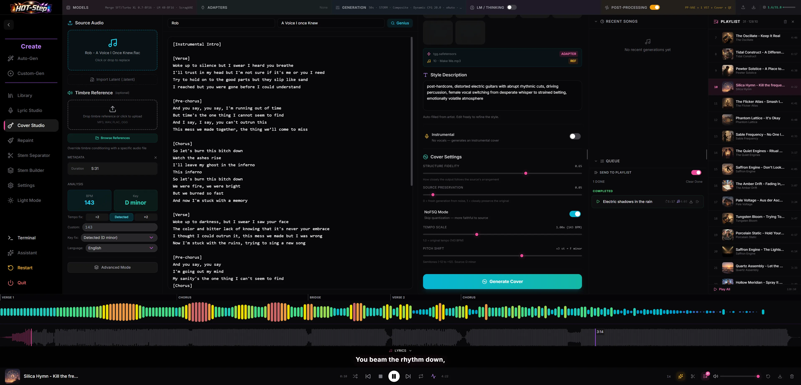

# Cover Studio

Make a new version of a recording. ACE-Step conditions its audio renderer on the
source; YuE2 transcribes the source into a lead sheet and composes from the
reviewed score. Both use your caption and lyrics or an Instrumental choice.

## Where to find it

Sidebar: **Cover Studio**. You need to be signed in to upload a source track, and
the active backend must support covers. ACE and YuE2 offer different cover workflows;
MiniMax-Music3 shows a "not supported" notice. The [backend switcher](../backends.md) appears once a second
backend is registered, so on a single-backend install this is not a decision you
have to make.

## ACE workflow

1. Drop a source track into the upload zone (MP3, WAV, FLAC, OGG, M4A, Opus, AAC),
   or send one over from [Library](library.md) with "Send to Cover Studio". A
   `.latent`/`.hslat` file exported from an earlier HOT-Step generation can be
   imported instead of audio, and pre-fills lyrics, caption, BPM and key from its
   embedded metadata.
2. The upload runs metadata extraction (artist/title/album/duration) and Essentia
   BPM/key analysis automatically. Re-adding a file you already analysed in this
   browser reuses the cached result instead of re-analysing.
   An uploaded source is saved as a cover draft on the server. If you close and
   reopen Cover Studio, the draft keeps its source identity and analysis.
   The studio's fields also save to a server draft about a second after each
   change. This browser's copy is still the one you edit. The draft belongs
   to this browser: another browser or tool that edits the same draft never
   overwrites your fields. If that happens, your next change is saved as a
   new draft and a short note under the header says so. If a save fails, a
   note says the draft wasn't saved; your edits stay in this browser, and the
   next change tries again. To go back to a saved draft, open **Load a saved
   draft** under the header and pick one; if the form has edits not yet saved
   to a draft, you are asked first. A draft whose uploaded source has gone
   missing is reported as unavailable, so you can reupload it. Loading a
   draft never starts a job.
   In YuE2 mode, the draft controls sit above the YuE2 settings. Enter a name
   and choose **Save named draft** to keep a separate snapshot of the current
   score and settings. **Load a saved draft** restores that snapshot. Leaving
   Cover Studio and returning also restores the current browser's score,
   adapter choices, caption, and other controls without a manual save.
3. Fix the analysis if Essentia got it wrong: the ÷2 / Detected / ×2 buttons and a
   free-text BPM box correct tempo halving or doubling, and a key dropdown
   overrides the detected key.
4. Optionally turn on Advanced Mode to split the source into stems, then mute or
   lower individual stems in the mixer that opens. Splitting alone changes
   nothing: an untouched split recombines at full volume, which is the original
   audio.
5. Fill in artist and title and search Genius for lyrics, paste your own, or turn
   on Instrumental to skip lyrics entirely.
6. Pick a target artist tile (optional). It auto-fills the Style Description from
   that artist's profile or past generations, and if a matching album preset
   carries an adapter, loads that adapter (and its reference track, if any) for
   the render. Skip this and write the Style Description yourself for an
   artist-free cover, using the Caption LLM button to draft one if you like.
7. Set Structure Fidelity, Source Preservation, Tempo Scale and Pitch Shift, and
   optionally a Timbre Reference track, then generate.

YuE2 saves the widths of the source, lyrics and score, and generation settings
columns in this browser. Drag the dividers to make room for the panel you are using.
Drag the divider below the lyrics to change the lead sheet height; that height is
saved too. Wide generation settings columns arrange controls side by side.

YuE2's **Render mode** offers Base YuE2 with a free-text Covering band label but no adapters, Existing Artist with a
trained Lyric Studio artist and album, and Custom with a covering band and hand-picked
AR composer and NAR renderer. Existing Artist lists only artists with at least one
album preset containing both YuE2 adapter paths. The selected mode and choices
are saved with the draft.

## YuE2 workflow

1. Choose **Source Audio** or **Import MusicXML** in the left panel. Source Audio
   accepts a recording of at most 100 MB and 10 minutes, or a song sent from
   Library. Detected BPM and key are shown for reference; they do not change
   the YuE2 cover request. In MusicXML mode, choose a `.musicxml`, `.xml` or `.mxl` file,
   select a part when prompted, and review conversion warnings. Switching modes
   clears the previous source and its score approval.
2. For Source Audio, click **Transcribe full score**. SheetSage2 writes the melody and detected
   chords into ABC. The score panel shows queue and transcription
   progress, with Cancel and Retry. SheetSage2 must be registered for automatic
   transcription; if it is missing, the panel shows the model setup guidance.
   In Source Audio mode you can also paste ABC or import MusicXML in the score
   editor to replace the transcribed ABC while keeping the source recording.
   In MusicXML mode the imported score already supplies ABC, without SheetSage2
   or a source recording. The file picker and drop area are in the left panel.
   Import writes the score in YuE2's own layout: the chosen part's melody on the
   Vocal voice, an Ins voice, 32nd-note lengths with ties, and pickup bars
   padded with rests. Tuplets round to the nearest 32nd with a warning. A grand
   staff starts with its top staff; choose another staff in the import picker.
   You can also choose a lyric verse. If the chosen verse is missing from the
   part, import uses verse 1 when present, then the first available verse; a
   part without lyrics imports without them. The first voice on the chosen staff supplies
   the melody. Other staves and parts fold into the single Ins line, which takes
   the highest sounding accompaniment note at each point. Repeats, alternate
   endings, D.C. and D.S. instructions play out before import. Key and meter
   changes remain in the score, and transposing
   instruments are written at sounding pitch. A later tempo change is ignored
   with a warning because YuE2 uses only the opening tempo. Long scores warn
   where YuE2's 5,120-token limit may cut them.
   Chord symbols in the file become chord symbols on the Vocal voice, written
   the way SheetSage2 writes them: at each change, and again at the start of
   every bar the chord carries into. A note that a change falls inside is split
   and tied, and a bar with no melody keeps its chord rather than becoming a
   rest. Roots are respelled for the key, as SheetSage2 does. Chord types
   YuE2 doesn't know are simplified to the nearest one it does (a ninth becomes
   a seventh), with a warning. When the file has no chord symbols, as most piano
   scores don't, chords are inferred for each bar, or each half bar where they
   change, from the other staves and parts. The warning says so; check them
   before approving, because the guess is a simple pitch-class match and can
   misread passing notes or name a seventh that isn't there. In MusicXML mode the
   score's title fills an empty Title field and its lyrics fill an empty lyrics
   box; text you have already typed is kept. A score with lyrics also turns
   **Instrumental** off, since that would discard them.
   Importing over an existing score asks before replacing it. Neither path uses
   source audio as an inference conditioning signal after approval.
   A score with no sounding Vocal bar fails transcription or submission with "The transcriber heard no melody in this source"; add a melody note before approving or generating.
3. Preview the full ABC, correct it in the editor, and click **Approve score**. Editing
   the score or changing the source audio, stem mix or source mode withdraws approval. The
   Generate button stays disabled until the current source has an approved score.
   For uploaded sources, transcription and approval use the draft's revision;
   a result from an older source or a cancelled transcription cannot replace the
   current score.
4. Paste lyrics or search by artist and title; choose **Instrumental** to render
   without lyrics. An Instrumental cover moves the melody to Ins whether or not
   re-planning is on; the score is already in hand. An instrument plays the
   score's Vocal melody instead of a wordless voice. Where
   both voices play at once the melody wins and Ins keeps only the notes it
   doesn't cover. Vocal keeps its chord symbols. On Base YuE2 the style also
   gains "Instrumental" and "no vocals, no singing, no choir, no spoken words";
   with an adapter pair the style is left as the adapter was trained. The
   generation log reports how many bars moved. Write a YuE2 style caption; Generate
   refuses to start without one, instrumental or not. With an adapter pair, you can
   choose a caption from its training tracks or the nearest detected BPM. The
   chosen caption fills the editable textarea, so later edits go into the render.
   The score's section strip shows each transcribed label and its starting bar.
   A warning compares these sections with `[Tag]` headers in your lyrics, but
   never blocks Generate.
   **Match sections to score** is available for Source Audio only. It separates the
   source's vocal (once per audio file: the same bytes are never separated
   again, even re-uploaded or after a restart; the stems are never deleted
   automatically), finds where each lyric block
   is sung, and retags each block with the score section it starts in. It
   never changes a word. Tags are written exactly as the score labels them,
   so `[Verse 1]` over a `verse` section becomes `[verse]` and the result
   passes the section check. A
   chorus (or refrain or hook) the lyrics wrote only once is copied into the
   later sections of that kind. Verses are never copied: each has its own words.
   Sections with no vocal get an empty tag such as `[interlude]`, which
   replaces the lyrics' own empty tags. A note held over into a section's
   first bar, such as the last word of a chorus ringing into the outro, does
   not count as singing there. A block that starts late in a section, starts in a section
   where the score has no vocal, or that the aligner could not place, keeps its
   tag and position and is listed for you to check.
   Nothing changes until you press **Apply** in the before/after view. For a
   dataset song there is no plain Apply: **Apply and save to dataset** applies
   the change and writes the lyrics into the song's `.txt` after a confirmation,
   so an accepted match is never lost on reload. If you edit the lyrics or score
   while the save runs, the save still lands but your edits are kept. The previous file is kept as `.txt.bak`.
   If a `.txt.bak` is already there, it is left alone and the previous file
   goes to `.txt.<date>-<time>.bak` instead, so no save loses a backup.
   **Match score to lyrics** has the same button for a dataset song. It writes
   the retagged lyrics to the `.txt` and the revised score to the song's `.abc`
   (the old score kept as `.abc.bak`, or a dated one the same way). A save is
   refused if the song's files changed since you matched, so match again. The
   `.txt` is written first; if the `.abc` then fails, you are told the lyrics
   were saved and the score was not. **Discard** writes nothing, uploaded
   sources never write to a dataset, and the Build page's lyrics never do
   either. Reopening the song brings the saved lyrics and score back without
   matching again.
   When a dataset song's tempo or key differs from the score's, Analysis
   shows the score's values with **Save to dataset**. After a confirmation it
   replaces the BPM and key in the song's `.txt`, keeping a backup the same way.
   If the transcriber counted half or double time, use **½×** or **2×** next
   to the score tempo first; the button saves the adjusted value. For uploaded
   sources, the server calculates that tempo and key from the current ABC and
   applies the confirmed dataset save.
5. Choose **Base YuE2** or an adapter pair. In pair mode, select a Lyric Studio
   artist and, if it has multiple albums with YuE2 adapters, an album. Cover
   Studio fills the matching AR and NAR adapters. Either manual selector can
   override that choice. The selected artist fills **Covering band**, which you
   can edit. Downloads use the filename prepend from Lyric Studio settings,
   followed by the covering band and the title with its source-band cover suffix.
   **Score to render** defaults to both the vocal and instrumental lines, no
   chord symbols, free tempo and source key. Choose vocal melody only if you
   want to omit the transcribed instrumental line; keep chords to preserve more
   of the original arrangement, retain or set tempo, or shift the key by up to
   twelve semitones. Keep chords also sets Chain of Thought: on, the render uses
   Full, so the chord symbols reach the composer; off, it uses Melody only. In
   MusicXML mode, Keep chords turns on by itself when the imported score has
   chord symbols, including inferred ones, and off when it has none; you can
   still change it. An Instrumental render keeps the chords on the Vocal voice
   when it moves the melody to Ins. Advanced **Condition strength** tightens style, lyrics and
   score together. Advanced **Lyric Timing (C6)** ties each lyric block to its score section's
   timing; Off by default, Soft and Hard stay selectable but condition strength 1 with either on
   ruins lyric adherence. The reviewed full score stays available. Click
   **Generate cover** on the **Prepare** tab for a one-shot render; queued renders
   keep all five choices, selected pair, score and settings from that click
   even if the picker changes later.

### Build by section

For a one-shot cover, **Generate cover** renders the song in one go. Choose
**Build by section** on **Prepare** to compare takes a few sections at a time.
It opens the **Build** tab, using the approved score, lyrics and settings from
Prepare. Finish preparing those before generating the first takes.

1. Two bars show the song. The **Source** bar is the score as it is, and never
   changes. The **Song** bar is the output you are building: built sections have
   ticks and start times, the next one has an arrow, and the rest are planned.
   Click a source section to add it to the end of the song; click it again to repeat
   it (a repeated chorus is its own entry on the Song bar). Hover a planned section
   to move it earlier or later, or remove it. Built sections are locked until you
   undo back to them. Click a planned section to build up to it; its lyrics, and the
   lyrics of the planned sections before it, appear beside the takes, one block per
   entry. **Ends the song** (on by default) marks the last section as the ending; turn
   it off to keep adding sections, since the last section cannot be built until
   something follows it or it is marked as the end. Editing the plan is refused while
   takes render, and takes made for an earlier plan can no longer be kept. The plan
   is saved with the build, so it survives a reload and is what **Save song** renders.
2. Choose 1 to 10 takes, then press **Generate N takes of A → B**, with the
   count and section names shown for your selection. Each take uses a fresh seed,
   continues everything kept so far, and stops a little beyond the chosen range.
   Takes render in groups of up to four, with one audio result per seed. Ten
   takes run as 4 + 4 + 2, and each group finishes before the next starts.
   The pending row shows the running group's shared stage and percentage, plus
   the total takes remaining. **Cancel** stops that group and skips later groups;
   earlier completed takes stay available. Wait for the pending row to clear
   before generating again.
   If a group fails or returns a missing or mismatched track, none of that
   group's takes are added and later groups stop. Earlier completed takes stay.
   Builds also work with **Condition strength** values other than 1.

   **Edit lyrics** (beside the takes) changes the lyrics for this build only.
   The Prepare page and the dataset's lyrics file are not touched, and you can
   edit before the first take exists. Each tag must be a line like `[verse]`, with
   no text above the first tag, and the text can be up to 20,000 characters.
   **Apply** saves them with the build, so they survive a reload and are what
   the next takes and **Save song** use. It is refused while takes are rendering
   (cancel or wait). Takes you made with the old lyrics stay listed, but their
   **Keep** is disabled; generate them again. Lyrics of sections you have
   already kept are locked, so kept audio stays as it was: undo back to a
   section to change its lyrics. **Use Prepare lyrics** puts the Prepare page's
   text back.
3. Play each take to compare it. Preview starts four seconds before its first new
   section, where available, so you can hear the join. Takes covering the first
   section play from the beginning. Each card shows a waveform, playhead and the new part's length.
   The play button pauses and resumes from the same spot; **Stop** resets. Click the
   waveform to seek within the preview, lead-in included. Playback stops when you
   keep, delete the take being played, undo, or leave the page.
   **Keep** adds that take to the build and advances to the next section. Use the
   trash button to delete an unwanted candidate.
4. Repeat for the remaining sections. **Play build** plays everything kept so far;
   clicking a built section plays from its start. To undo a keep, open **Build
   actions** and choose **Undo last keep**. A built section's undo button rolls
   back far enough to build that section again.
5. Click **Save song** to submit everything kept so far as an ordinary generation
   job, even if some sections remain unbuilt. It uses the kept audio codes and
   receives the usual post-processing, drift check and Library save. Once the
   song is saved, the build clears so the next Build starts fresh. If the save
   fails, is cancelled or times out, the build stays so you can save again.

**AR strength** (0 to 10, default 0.6) is Cover Studio's own setting, shown on
both Prepare and Build. It replaces the adapter picker's AR scale for every
Cover render, including 0. Values above 0.6 hurt adherence to the score: on
one seed, 1.0 matched 11% of chords against 89% at 0.6. A build keeps the
value it started with; the control locks until you start over.

Once the first takes start, the build's settings, score and lyrics are fixed.
Edits on Prepare do not change that build. Choose **Start over** in Build actions
or beside **Build in progress** on Prepare to unlock them for a new build.
**Open** on Prepare returns to the existing build.

A take's seed reproduces its composition only with the same group size. The
same seed rendered alone can differ from one rendered in a group of four.

YuE2 does not use ACE's fidelity, source-preservation/noise, NoFSQ, timbre,
latent or BPM/key correction controls. The YuE2 score tempo and pitch controls
change ABC before composition, rather than source audio. A completed YuE2 cover
uses the ordinary generation queue and appears in Library. Its saved job records
the source kind, a recording identity for Source Audio, the reviewed full score,
the five render choices and the ABC actually rendered. MusicXML mode has no
recording identity; its title comes from the score unless you edit the Title
field, while lyrics and style come from the fields you set. YuE2 ends duration
when its model finishes the song.

After the file upload finishes, Cover Studio shows **Analyzing** while it opens
the source. When its audio exactly matches one unambiguous dataset track and
that track's sidecar has valid BPM and key, it uses those values without running
Essentia. Cover Studio also reads eligible dataset lyrics, labels them **from
dataset**, skips the Genius lookup, and lets you edit them. An instrumental
sidecar selects Instrumental. If the sidecar is absent or incomplete, the
usual lookup and analysis path applies. Dataset lyrics are recorded as such in
the cover's generation parameters until you edit them. A saved `<stem>.abc`
beside the dataset audio opens in the score editor without a transcription job;
**Retry transcription** replaces that saved score after a successful run.

## ACE-Step controls

| Control | What it does |
|---|---|
| Source Audio | Upload zone for the reference track. Drag-drop or click to browse. |
| Latent import | Alternative to Source Audio: load a `.latent`/`.hslat` file and reuse its embedded lyrics/caption/BPM/key. |
| Timbre Reference (optional) | A second reference track (upload or pick from saved references) fed to the engine as a DiT timbre conditioner, independent of any adapter's own reference track. |
| Tempo fix: ÷2 / Detected / ×2 | Corrects Essentia's common tempo halving/doubling error. |
| Custom (BPM) | Free-text BPM override, 20 to 300, replaces the corrected detected value. |
| Key fix | Dropdown of all 24 major/minor keys, overrides the detected key. |
| Language | Vocal language used for the generation. |
| Advanced Mode | Splits the source into stems (SuperSep, selectable separation level), then opens a mixer for muting or attenuating individual stems before generation. |
| Target Artist (optional) | Grid of trained artists. Selecting one auto-fills Style Description and, when available, an album adapter preset. |
| Album | Appears when the selected artist has more than one album preset with an adapter; picks which one to apply. |
| Style Description | Free-text caption for genre, instruments, vocal style, production and mood. Auto-filled from the target artist, always editable. Its Generate button redrafts it with the selected Caption LLM provider on demand; the same provider fills it automatically on artist selection when no existing caption is found. |
| Instrumental | Skips the lyrics requirement and sends the track as instrumental. |
| Structure Fidelity | 0 to 1, default 0.5. How closely the output follows the source's arrangement. |
| Source Preservation | 0 to 1, default 0. "0 = fresh generation from noise, 1 = closely preserve the original." Above 0, a Noise Method choice appears. Classic (Truncate), the default, drops the early steps and runs the rest. Full Denoise (Rescale) runs the same number of steps, spaced by the selected scheduler across the remaining range. |
| NoFSQ Mode | Toggle. Skips FSQ quantization for a result closer to the source. |
| Tempo Scale | 0.5x to 2.0x, default 1.0. Scales the target BPM from the (corrected) source BPM. |
| Pitch Shift | -12 to +12 semitones, default 0. Shows the transposed target key live. |

Every slider's value is click-to-edit: click the number next to a slider to type
an exact figure instead of dragging. A reset arrow appears beside a label whenever
its value has moved from the default; click it to snap that one field back.

## Tips and limits

- Cover generation needs ACE or YuE2 active. MiniMax-Music3 replaces the studio
  with a not-supported notice.
- Splitting into stems is step one of two. The split by itself does not change the
  render; the mixer is where muting or lowering a stem actually removes it from
  the cover.
- For ACE-Step, BPM/key detection depends on the bundled Essentia analyzer. If it returns a
  wrong value, use the tempo-fix and key-fix controls above to correct it. If it
  fails outright, the source loads with no detected-BPM/key panel at all and
  generation falls back to a default of 120 BPM.
- Source filename, detected metadata and lyrics are cached in the browser, so
  re-uploading a track you already analysed here skips analysis and reuses the
  cache.
- Covers queue rather than block the UI: you can adjust settings and start another
  cover while one is still rendering. Uploaded-source covers are submitted to the
  server as soon as you start them, so a queued cover remains there if you close
  or reload the page.
- For ACE-Step, if Whisper lyric transcription is enabled in [generation](../generation.md)
  settings, generated covers get the same LRC-synced lyrics as any other track.
- Finished covers save to the library tagged with their source, alongside every
  other generation; open [Library](library.md) to find, play or export one.

Artist, lyrics-set and preset lists reuse recent results when you return.
Transcription and section-build status refresh while active and stop at the
end. Returning to Cover Studio does not start a new transcription or render;
your lyric edits and queued execution remain separate from list refreshes.

## Related

- [Create](create.md)
- [Repaint Studio](repaint-studio.md)
- [Library](library.md)
- [Generation](../generation.md)
- [Backends](../backends.md)
- [Adapters](../adapters.md)
